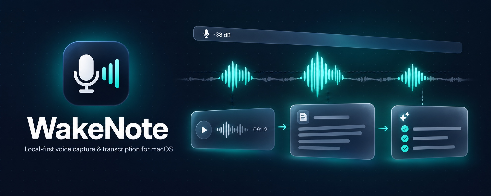
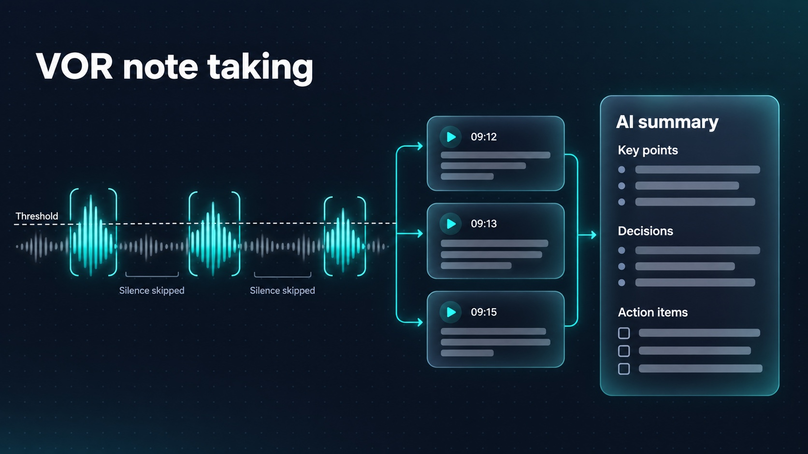
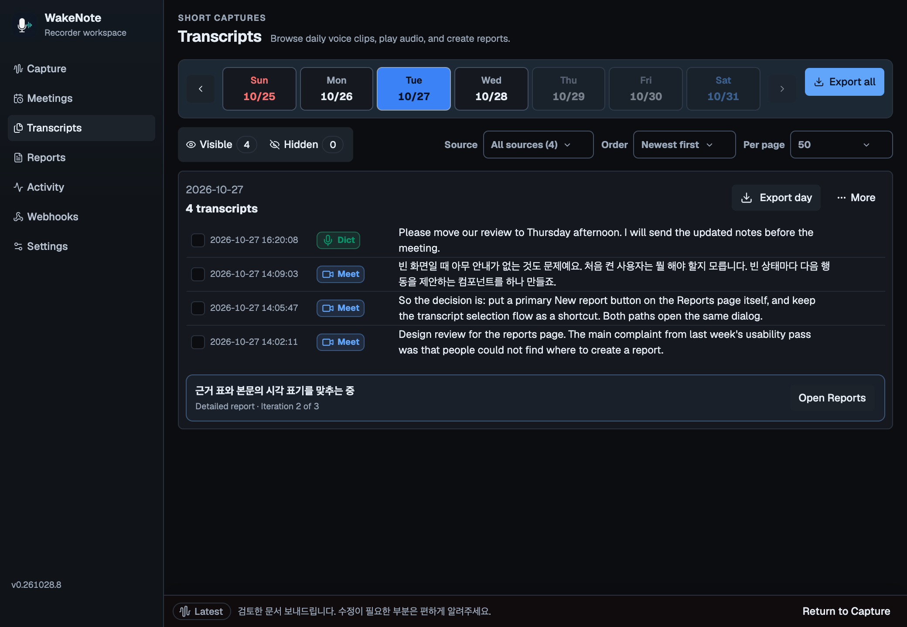
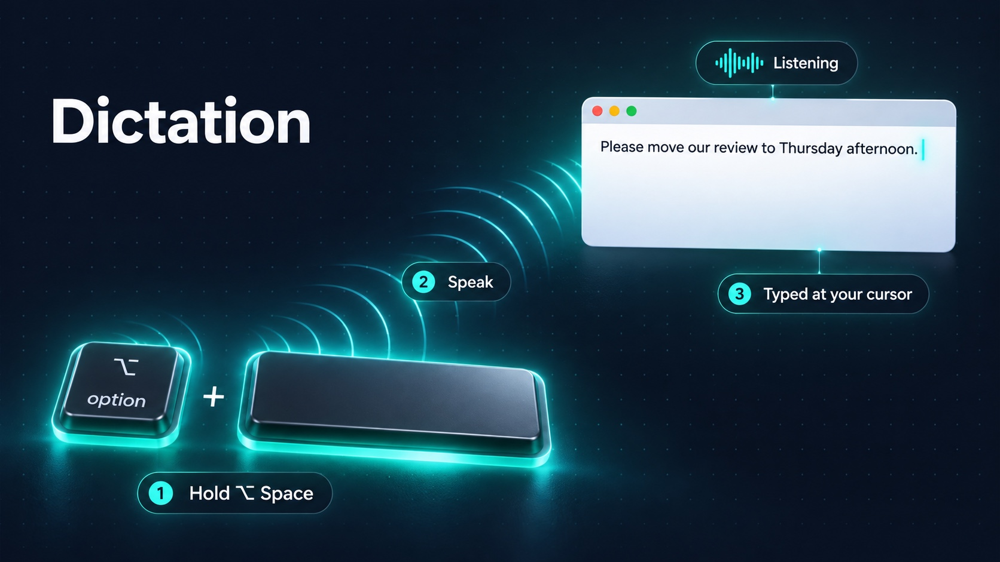
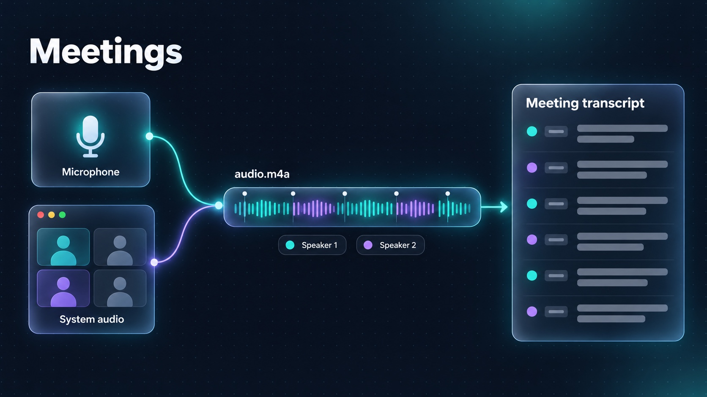

# WakeNote

[한국어 README](README.md)



**Local-first voice capture and transcription for macOS.**

WakeNote is a menu-bar recorder for one or two microphones, supported system-audio sources, imported recordings, and dictation with hold or toggle hotkeys. It turns speech into durable audio, metadata, transcript, and report files while letting you choose between on-device ASR and explicitly configured cloud providers.

The desktop app uses Tauri 2 and Rust for capture, persistence, and transcription, with a React 19 and TypeScript workspace for Capture, Meetings, Transcripts, Reports, Activity, and Settings.

## Core features

WakeNote records speech in three ways: **VOR note taking** listens in the background and keeps only the moments when the input rises above a threshold, **Dictation** types what you say at the cursor after you hold a hotkey and speak, and **Meetings** records and transcribes long conversations in one piece. The app screenshots below were taken in the `pnpm dev` browser preview with its sample data.

### VOR note taking



VOR (voice-operated recording) records only while the input is louder than a threshold. Leave WakeNote running and every stretch of sound above the threshold becomes a short recording, while long silences are never written to disk.

- **Skips silence** — A dBFS threshold with attack and release timing starts a recording only when the input gets loud enough, and pre-roll, lead-in, and post-roll keep the first and last words intact. **Calibration** finds a threshold that sits above your room noise.
- **Transcribes automatically** — Each finished recording joins the transcription queue right away. Run Whisper, sherpa-onnx, or Qwen3-ASR on your Mac, or choose a cloud provider after saving its API key.
- **Keeps a daily record** — Results collect by date in **Transcripts**, where you can play the audio or export a whole day.
- **Turns the day into notes** — Select transcripts in **Transcripts** and choose **Summary** or **Report**, or start from **Reports › New report**, to get Markdown notes with key points, decisions, action items, and open questions. Reports run only when you start them, after an OpenRouter API key is saved.
- **Shows the level in the menu bar** — Turn on **Settings › General › Show input level in menu bar** to see the current input level in dB beside the menu bar icon. It is off by default.



### Dictation



Hold a hotkey in any app, speak, and the transcript is typed wherever your cursor is.

- **Hold to dictate** — Hold **Control+Shift**, the default **Hold-to-dictate hotkey**, to record, then release it to transcribe and type. A hotkey you saved earlier keeps working.
- **Toggle and cancel** — You can also set a separate **Toggle dictation hotkey**: press it once to start recording and again to stop. To cancel, press **Escape** in the WakeNote window, press a dictation hotkey again while it is transcribing, or choose **Cancel Current Operation** from the menu bar.
- **Picks the cleaner microphone** — Dictation uses the Primary and optional Secondary microphones and keeps whichever signal is cleaner. VOR recording continues during Dictation, but overlapping speech is transcribed only once.
- **Recent results** — **Recent Dictations** shows the ten latest results to reread or copy, and **Transcripts** can filter to dictations only.
- **Translation and Enhanced Prompt (optional)** — Have WakeNote type a translation instead of the original transcript, or use the separate Enhanced Prompt shortcut (default **Control+Option+Space**) to turn a spoken draft into a structured prompt. Both use OpenRouter and are off by default.

Turn on Dictation in **Settings › Dictation**. Typing at the cursor requires the Accessibility permission. Because Control+Shift uses modifier keys only, it also starts recording when you begin another shortcut such as Control+Shift+T; choose a combination with a regular key if that gets in the way.


### Meetings



Record and transcribe long meetings in **Meetings**, separately from VOR note taking. For online calls, your voice and the other participants' voices end up in the same file.

- **Microphone and system audio together** — **Start recording** captures the microphone and system audio into a single `audio.m4a`, for up to five hours per recording. Meeting recording needs both the Microphone and the Screen & System Audio Recording permissions; without either one, **Start recording** does not begin.
- **Transcribe when ready, resume after interruptions** — Choose a model and transcribe after the recording ends. Progress is saved to `meeting.json` after each segment, so **Resume** continues interrupted work from where it stopped.
- **Import existing recordings** — Bring in `mp3`, `m4a`, or `wav` files and transcribe them the same way.
- **Speaker separation (optional)** — Choose a model that supports it (currently only OpenAI GPT-4o Transcribe Diarize) and turn on **Speaker separation** when you start transcription to split the transcript into speaker turns. It is off by default.


## Feature summary

- **Automatic capture** — a calibrated dBFS gate, attack/release timing, pre-roll, lead-in, and post-roll preserve speech without continuously writing silence.
- **Flexible dual microphones** — Keep Primary and Secondary separate, adaptively synchronize and merge them, or use Priority Audio to record whichever input is currently cleanest without summing both microphones.
- **Local and opt-in cloud ASR** — Whisper, sherpa-onnx, and Qwen3-ASR run locally; OpenRouter, OpenAI, and Soniox are available only after their API keys are saved.
- **Live and archival workflows** — Customizable Subtitles, independent hold and toggle dictation hotkeys, Recent Dictations with copy and history actions, a dedicated Dictations filter, paged daily transcript and Activity history, M4A meeting recordings, and Markdown reports share the same model and Dictionary contracts.
- **Focused-cursor tools** — Realtime auto-type has its own model selection. Opt-in OpenRouter translation supports Subtitles, Transcripts, and Dictation; a separate Enhanced Prompt shortcut, also opt-in and processed through OpenRouter, turns spoken drafts into structured prompts with an editable system prompt.
- **Durable recovery** — queued jobs survive restarts, running work can be cancelled safely, and selected recording bundles move to macOS Trash together instead of leaving text, JSON, or audio behind.
- **Inspectable storage** — audio, metadata, transcripts, recoverable errors, meetings, and reports stay under a user-selected save root.

## Installation

### Install a release

1. Download `WakeNote_<version>_aarch64.dmg` from the [latest GitHub release](https://github.com/channprj/wakenote/releases/latest). Published builds target Apple Silicon Macs running macOS 15.5 or later.
2. Open the DMG and drag **WakeNote** into **Applications**.
3. On the first install, run this once in Terminal before opening the app:

```bash
xattr -dr com.apple.quarantine /Applications/WakeNote.app
```

WakeNote is ad-hoc signed and not notarized, so Gatekeeper blocks the first launch of a copy downloaded in a web browser, which carries the macOS quarantine flag. Removing the flag once lets it open. Updates installed from inside WakeNote do not add the flag, so they do not need this step again; repeat it only after replacing the app with a DMG you downloaded yourself. To verify the download against `SHA256SUMS.txt` first, see [Install a published release](USAGE.md#install-a-published-release).

### Build from source

Install Node.js 20+, `pnpm` 10, the stable Rust toolchain, Xcode Command Line Tools, and CMake. On macOS, install CMake with `brew install cmake`, then run:

```bash
pnpm install
pnpm tauri dev
```

See [Usage](USAGE.md#installation) for macOS permissions, optional model prerequisites, release builds, local installation, and DMG packaging.

## Local releases

GitHub Actions is disabled for this repository. Publish from your Mac; the command reuses a verified current build or builds it first:

```bash
pnpm release:publish --dry-run
pnpm release:publish
```

Commit synchronized versions and push the branch and annotated version tag before publishing. `--dry-run` reports whether a build is needed without building or publishing. Use `pnpm release:build` to prepare artifacts separately. Artifacts go to `release/v<version>/<architecture>/`; each build targets the current Mac only. The app is ad-hoc signed and not notarized. See the [release procedure](USAGE.md#local-build-and-manual-github-release) for prerequisites, draft releases, and recovery.

## Quick start

1. Open **Settings › Audio**, allow Microphone access, and select the Primary input. Add a distinct Secondary input only when needed.
2. Open **Settings › Storage**, choose and confirm the save root.
3. Open **Settings › Models**, install or select a model. Add cloud keys only under **Settings › Integrations**.
4. Return to **Capture** and confirm that the live level crosses the configured threshold while speaking.
5. Review completed work in **Transcripts** and queue outcomes in **Activity**.

The default archive root is `~/Documents/WakeNote`; the default local model is `whisper-medium`.

## More documentation

- [Usage](USAGE.md) — installation, commands, configuration, model capabilities, examples, and troubleshooting
- [Architecture](ARCHITECTURE.md) — components, data flows, persistence boundaries, and design decisions

## License

WakeNote is licensed under the [MIT License](LICENSE). Bundled third-party components retain their own licenses.
