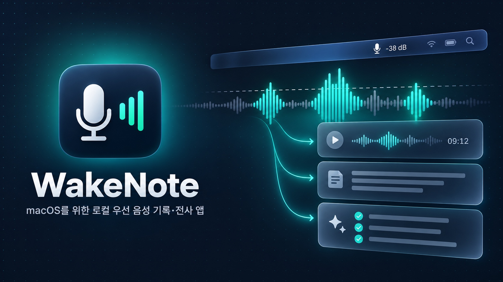
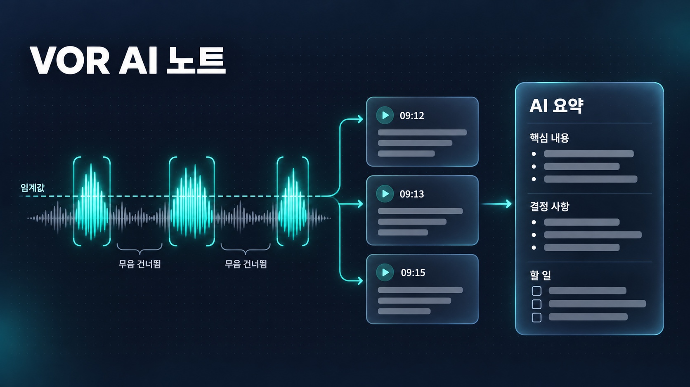
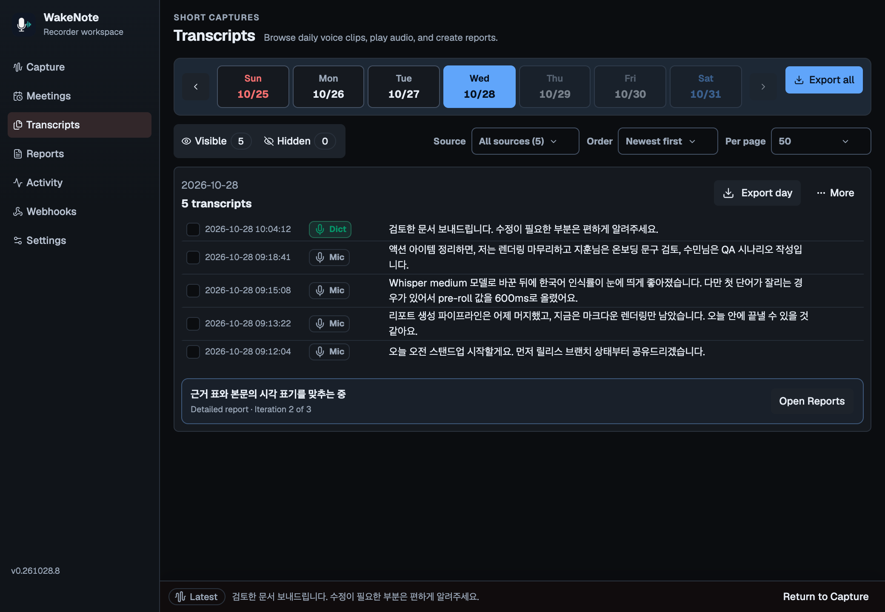
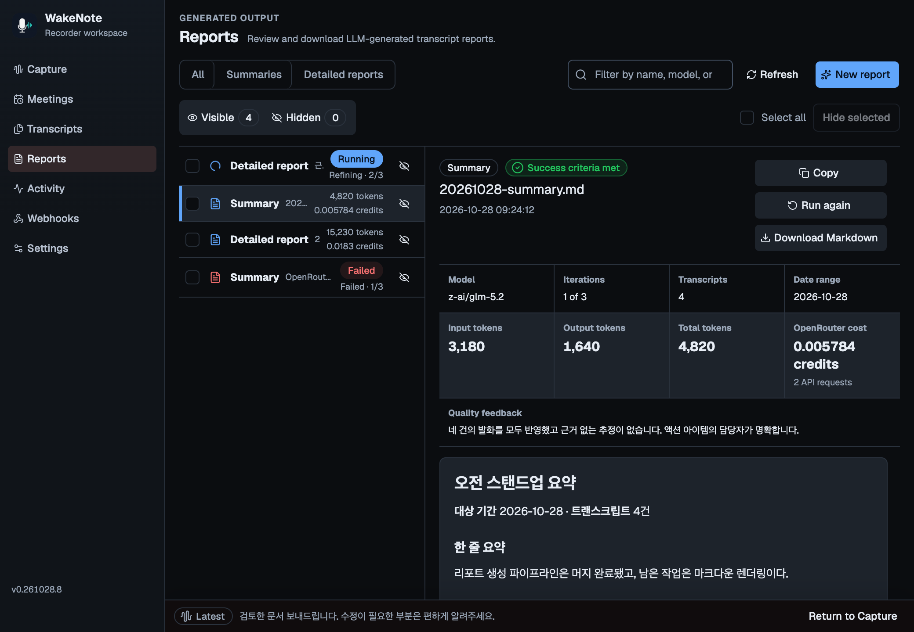
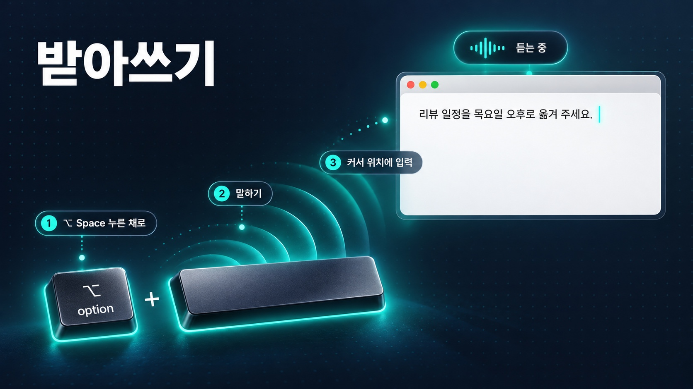
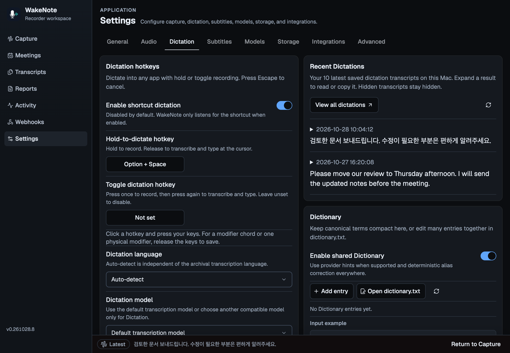
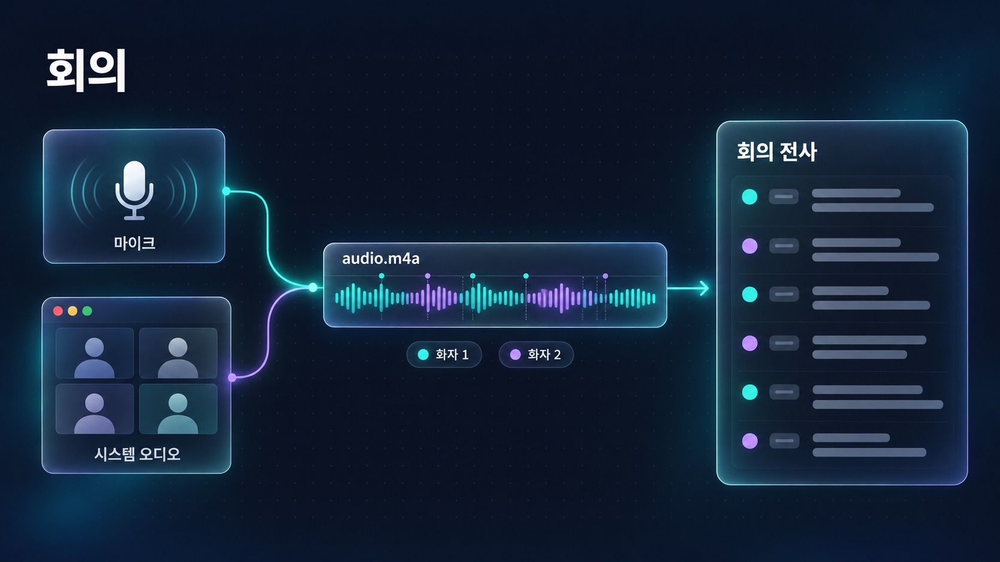
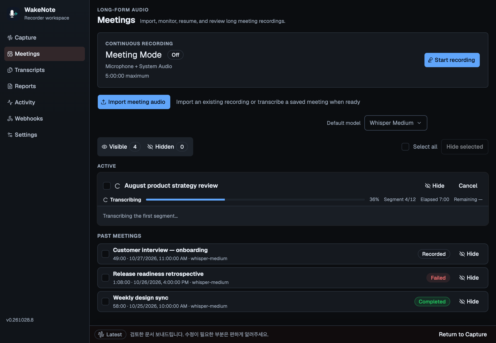

# WakeNote

[English README](README.en.md)



**macOS를 위한 로컬 우선 음성 캡처 및 전사 앱입니다.**

WakeNote는 마이크 한두 개, 지원되는 시스템 오디오 소스, 가져온 녹음 파일, 누르고 말하거나 토글 단축키로 시작·종료하는 받아쓰기를 다루는 메뉴 막대 녹음 앱입니다. 음성을 오래 보존할 수 있는 오디오·메타데이터·전사·보고서 파일로 만들며, 온디바이스 ASR과 명시적으로 설정한 클라우드 provider 중에서 선택할 수 있습니다.

데스크톱 앱은 캡처·영속성·전사를 위해 Tauri 2와 Rust를 사용하고, Capture·Meetings·Transcripts·Reports·Activity·Settings 작업 공간은 React 19와 TypeScript로 구성합니다.

## 핵심 기능

WakeNote는 음성을 세 가지 방식으로 기록합니다. 켜 두면 소리가 임계값을 넘을 때만 녹음해 노트로 남기는 **VOR AI 노트**, 단축키를 누르고 말하면 커서 위치에 글이 입력되는 **받아쓰기**, 긴 회의를 통째로 녹음하고 전사하는 **회의**입니다. 아래 앱 화면은 `pnpm dev` 브라우저 미리보기에서 샘플 데이터로 찍었습니다.

### VOR AI 노트



VOR(Voice-Operated Recording)은 소리가 임계값을 넘을 때만 녹음하는 방식입니다. WakeNote를 켜 두면 소리가 난 구간은 짧은 녹음 파일로 저장되고, 긴 무음 구간은 파일로 남지 않습니다.

- **무음은 건너뛰고 녹음** — dBFS 임계값과 attack·release 시간으로 소리가 임계값을 넘는 구간만 녹음하고, pre-roll·lead-in·post-roll로 첫 단어와 마지막 단어가 잘리지 않게 합니다. **Calibration**으로 주변 소음보다 높은 임계값을 찾을 수 있습니다.
- **자동 전사** — 녹음이 끝난 구간은 바로 전사 대기열에 들어갑니다. Whisper, sherpa-onnx, Qwen3-ASR로 Mac 안에서 처리하거나, API key를 저장한 클라우드 provider를 고를 수 있습니다.
- **날짜별 기록** — 결과는 **Transcripts**에 날짜별로 쌓이며, 여기서 오디오를 재생하거나 하루치 기록을 한꺼번에 내보낼 수 있습니다.
- **AI 노트** — **Transcripts**에서 기록을 골라 **Summary**나 **Report**를 누르거나 **Reports › New report**에서 만들면, 핵심 내용, 결정 사항, 할 일, 남은 질문을 정리한 Markdown 노트가 생깁니다. 보고서는 OpenRouter API key를 저장한 뒤 직접 실행할 때만 만들어집니다.
- **메뉴 막대 레벨** — **Settings › General**에서 **Show input level in menu bar**를 켜면 메뉴 막대 아이콘 옆에 현재 입력 레벨이 dB로 표시됩니다. 기본적으로 꺼져 있습니다.

<p align="center">
  
  
</p>

### 받아쓰기



어느 앱에서든 단축키를 누르고 말하면, 전사한 글이 지금 커서가 있는 곳에 바로 입력됩니다.

- **두 가지 단축키** — 기본 단축키 **Option+Space**를 누르고 있는 동안 녹음하고, 손을 떼면 전사해 입력합니다. 한 번 눌러 시작하고 다시 눌러 끝내는 토글 단축키도 따로 정할 수 있습니다. 취소하려면 WakeNote 창에서 **Escape**를 누르거나, 전사 중에 받아쓰기 단축키를 다시 누르거나, 메뉴 막대의 **Cancel Current Operation**을 고르세요.
- **더 깨끗한 마이크 선택** — Primary와 Secondary 마이크 중 신호가 더 깨끗한 쪽을 자동으로 씁니다. 받아쓰기 중에도 VOR 녹음은 이어지지만, 겹친 구간은 한 번만 전사합니다.
- **최근 기록** — **Recent Dictations**에서 최근 10개 결과를 다시 읽고 복사할 수 있고, **Transcripts**에서는 받아쓰기만 골라 볼 수 있습니다.
- **번역과 Enhanced Prompt(선택)** — 받아쓴 내용을 번역해 입력하거나, 별도 단축키(기본값 **Control+Option+Space**)로 말한 초안을 정리된 프롬프트로 바꿔 입력합니다. 둘 다 OpenRouter를 쓰며 기본적으로 꺼져 있습니다.

받아쓰기는 **Settings › Dictation**에서 켜야 동작하고, 커서 위치에 글을 입력하려면 손쉬운 사용(Accessibility) 권한이 필요합니다.



### 회의



긴 회의는 **Meetings**에서 따로 녹음하고 전사합니다. 온라인 회의라면 내 목소리와 상대방 목소리를 한 파일에 함께 남길 수 있습니다.

- **마이크와 시스템 오디오 함께 녹음** — **Start recording**을 누르면 마이크와 시스템 오디오를 함께 녹음해 `audio.m4a` 하나로 저장합니다. 한 번에 최대 5시간까지 녹음할 수 있습니다. 회의 녹음에는 마이크 권한과 화면 및 시스템 오디오 녹음 권한이 모두 필요하며, 둘 중 하나라도 없으면 녹음이 시작되지 않습니다.
- **원할 때 전사, 중단돼도 이어서** — 녹음을 마친 뒤 원하는 모델을 골라 전사합니다. 구간마다 진행 상황을 `meeting.json`에 저장하므로, 중간에 멈춘 전사는 **Resume**으로 이어서 처리할 수 있습니다.
- **기존 녹음 가져오기** — `mp3`, `m4a`, `wav` 파일을 가져와 같은 방식으로 전사합니다.
- **화자 분리(선택)** — 화자 분리를 지원하는 모델(현재는 OpenAI GPT-4o Transcribe Diarize뿐)을 고르고 전사를 시작할 때 **Speaker separation**을 켜면 전사 결과를 화자별로 나눕니다. 기본적으로 꺼져 있습니다.



## 기능 요약

- **자동 캡처** — 보정 가능한 dBFS gate와 attack/release timing, pre-roll, lead-in, post-roll로 긴 무음 구간을 계속 저장하지 않으면서 발화를 보존합니다.
- **유연한 듀얼 마이크** — Primary와 Secondary를 따로 저장하거나 적응형 동기화 후 합칠 수 있으며, Priority Audio로 두 입력을 섞지 않고 현재 가장 깨끗한 입력만 녹음할 수도 있습니다.
- **실시간 입력과 프롬프트 변환** — 오토타입 모델을 별도로 선택하고, 자막·전사·딕테이션의 번역 언어를 지정할 수 있습니다. Enhanced Prompt의 별도 단축키로 말한 초안을 프롬프트로 정리하며, 시스템 프롬프트도 수정할 수 있습니다. 번역과 프롬프트 변환은 선택적으로 켜는 OpenRouter 기능입니다.
- **로컬 및 opt-in 클라우드 ASR** — Whisper, sherpa-onnx, Qwen3-ASR는 로컬에서 실행되며 OpenRouter, OpenAI, Soniox는 해당 API key를 저장한 뒤에만 사용할 수 있습니다.
- **받아쓰기와 기록 확인** — Hold-to-dictate hotkey와 Toggle dictation hotkey를 따로 지정할 수 있습니다. Recent Dictations에서 최근 결과를 읽고 복사하거나 해당 날짜로 이동하며, Transcripts의 Dictations 필터로 받아쓰기만 모아 볼 수 있습니다.
- **실시간 및 보관 workflow** — 커스터마이징 가능한 Subtitle, 페이지 처리된 날짜별 Transcripts·Activity 기록, M4A 회의 녹음, Markdown 보고서가 동일한 model 및 Dictionary 계약을 공유합니다.
- **지속 가능한 복구** — queue job은 재시작 후에도 유지되고, running 작업은 안전하게 취소할 수 있으며, 선택한 녹음 bundle은 텍스트·JSON·오디오를 빠뜨리지 않고 macOS 휴지통으로 함께 이동합니다.
- **확인 가능한 저장 구조** — 오디오, 메타데이터, 전사, 복구 가능한 오류, 회의, 보고서가 사용자가 선택한 save root 아래에 남습니다.

## 설치

### 릴리스로 설치

1. [최신 GitHub 릴리스](https://github.com/channprj/wakenote/releases/latest)에서 `WakeNote_<version>_aarch64.dmg`를 내려받으세요. 게시된 빌드는 macOS 15.5 이상의 Apple Silicon Mac용입니다.
2. DMG를 열고 **WakeNote**를 **Applications**로 드래그하세요.
3. 처음 설치했다면 앱을 열기 전에 터미널에서 다음 명령을 한 번 실행하세요.

```bash
xattr -dr com.apple.quarantine /Applications/WakeNote.app
```

WakeNote는 ad-hoc 서명만 되어 있고 공증을 받지 않았습니다. 그래서 웹 브라우저로 내려받은 앱에는 macOS의 격리(quarantine) 표시가 붙고, Gatekeeper가 첫 실행을 막습니다. 이 표시를 한 번 지우면 정상적으로 열립니다. WakeNote 안에서 설치한 업데이트는 이 표시를 남기지 않으므로 명령을 다시 실행할 필요가 없습니다. DMG를 직접 내려받아 앱을 교체했을 때만 이 명령을 다시 실행하세요. 내려받은 파일을 `SHA256SUMS.txt`로 먼저 확인하려면 [릴리스 설치 절차](USAGE.md#install-a-published-release)를 참고하세요.

### 소스에서 빌드

Node.js 20+, `pnpm` 10, stable Rust toolchain, Xcode Command Line Tools, CMake를 설치하세요. macOS에서는 `brew install cmake`로 CMake를 설치한 뒤 다음을 실행하세요.

```bash
pnpm install
pnpm tauri dev
```

macOS 권한, 선택 모델별 추가 요구사항, release build, 로컬 설치, DMG packaging은 [사용법](USAGE.md#installation)을 참고하세요.

## 로컬 릴리스

이 저장소의 GitHub Actions는 비활성화되어 있습니다. Mac에서 직접 게시하세요. 게시 명령은 현재 소스와 맞는 검증된 빌드가 있으면 그대로 쓰고, 없으면 먼저 빌드합니다.

```bash
pnpm release:publish --dry-run
pnpm release:publish
```

게시 전에 동기화한 버전을 커밋하고, 브랜치와 annotated 버전 태그를 푸시하세요. `--dry-run`은 빌드하거나 게시하지 않고 빌드가 필요한지만 알려 줍니다. 산출물만 따로 준비하려면 `pnpm release:build`를 쓰세요. 산출물은 `release/v<version>/<architecture>/`에 저장되며, 각 빌드는 현재 Mac의 아키텍처용으로만 만들어집니다. 앱은 ad-hoc 서명을 사용하고 공증되지 않습니다. 필요한 도구, 초안 릴리스와 실패 시 처리 방법은 [릴리스 절차](USAGE.md#local-build-and-manual-github-release)를 참고하세요.

## 빠른 시작

1. **Settings › Audio**에서 Microphone 접근을 허용하고 Primary 입력을 선택하세요. 필요할 때만 서로 다른 Secondary 입력을 추가하세요.
2. **Settings › Storage**에서 save root를 선택하고 확인하세요.
3. **Settings › Models**에서 model을 설치하거나 선택하세요. 클라우드 key는 **Settings › Integrations**에서만 추가하세요.
4. **Capture**로 돌아가 말할 때 live level이 설정한 threshold를 넘는지 확인하세요.
5. 완료된 결과는 **Transcripts**, queue 결과는 **Activity**에서 검토하세요.

기본 archive root는 `~/Documents/WakeNote`이고 기본 local model은 `whisper-medium`입니다.

## 자세한 문서

- [사용법](USAGE.md) — 설치, 명령, 설정, model capability, 예제, 문제 해결
- [아키텍처](ARCHITECTURE.md) — component, data flow, 영속성 경계, 설계 결정

## 라이선스

WakeNote는 [MIT 라이선스](LICENSE)로 배포됩니다. 포함된 외부 구성 요소에는 각각의 라이선스가 적용됩니다.
